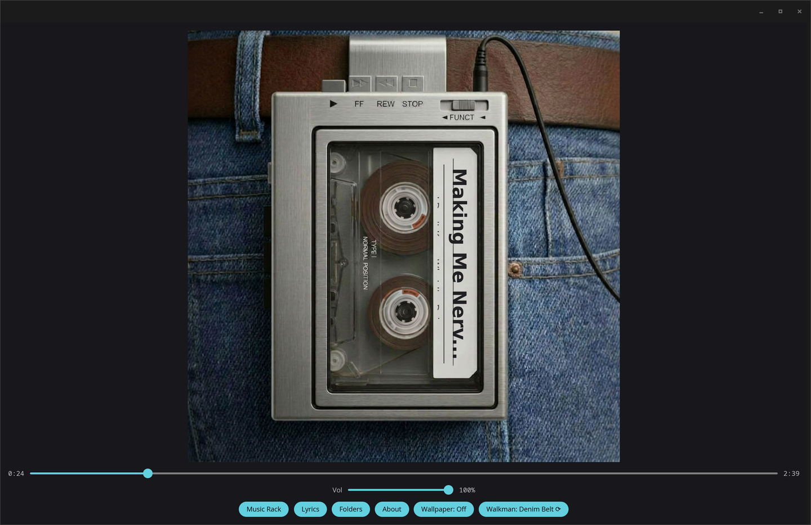
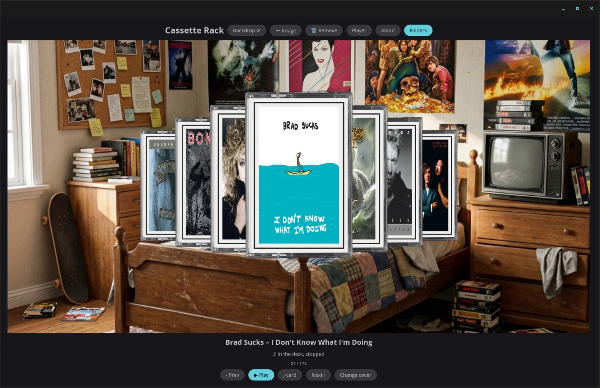
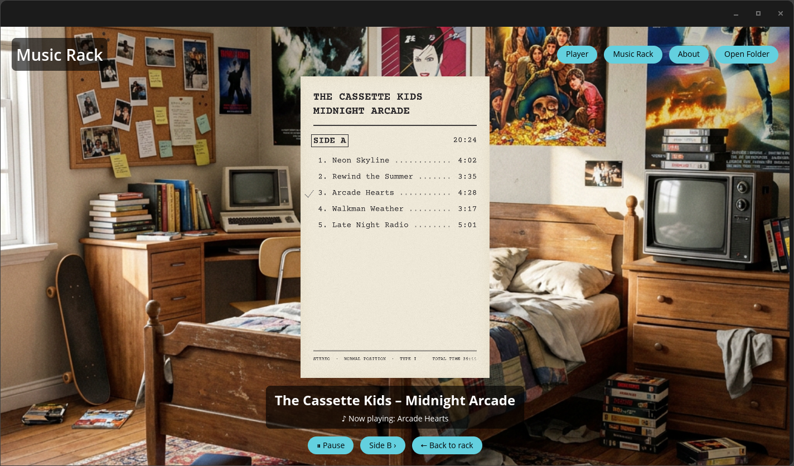
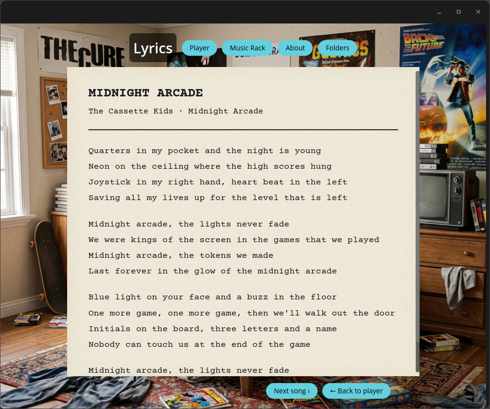
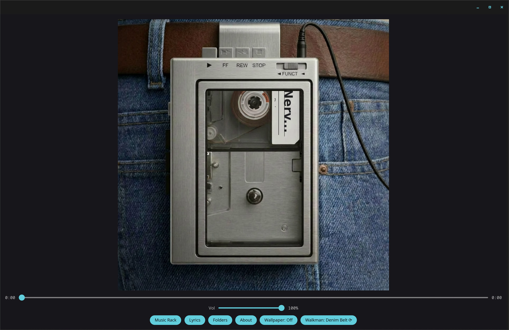
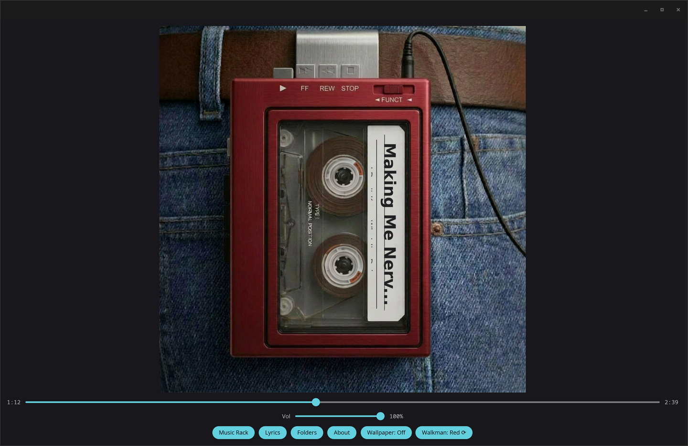

# cosmic-cassette-deck

A 1980s portable cassette player for your own music, built as a native app for the COSMIC desktop.

The deck is a real photograph. The reels spin, the keys press down, and every album is a cassette you pull off a shelf and drop into the deck.

<p align="center">
  
</p>

## What it does

- **Spinning reels:** they turn like a real tape. One reel empties and speeds up as the other fills and slows.
- **Loading a tape:** click a cassette on the rack and its case swings open, the tape lifts out and slides into the deck. Music starts as it clicks into place.
- **Eject and swap:** press Stop twice and the tape pops back out. When an album ends, the old tape slides out and the next one slides in.
- **Real keys:** they sink when pressed and spring back. Play stays down while the tape plays and pops up on pause or stop.
- **Printed label:** the tape's label shows the song and album from your music files.
- **J-card:** the folded insert from the cassette case, with the album's songs typed out on old paper and split into Side A and Side B.
- **Lyrics:** a lyric sheet for the song that's playing, when its lyrics can be found.
- **Cassette Rack:** flip through your albums like a shelf of tapes, with their covers, sorted by artist. It follows the tape that's playing and marks it "♪ In the deck".
- **Five colours:** Denim Belt, Red, Blue, Black and White.
- **Your own backgrounds:** swap the room behind the rack, or add a picture of your own.
- **Album wallpaper:** optionally fill the space around the deck with the playing album's cover.
- **Tape sounds:** the keys click, the case snaps open, the tape rattles in and clunks into place, fast-forward whirrs, and a tape clunks to a stop at its end.
- **Media keys:** your keyboard's media keys and your desktop's player controls work.
- **Picks up where you left off:** the last song and position are remembered.
- **Formats:** MP3, FLAC, M4A/AAC and WAV.

## Screenshots

**Cassette Rack:** one cassette per album, with its cover. Browse with the arrow keys or Prev and Next. Click the cassette at the front, or Play, to put it in the deck.



**J-card:** click **J-card** to read the album's songs. **Side B ›** turns it over. Click the tape label on the Player to see the J-card of the tape that's playing, with a pencil tick beside the current song.



**Lyrics:** click **Lyrics** on the Player or the J-card to read the words. The button only shows up when the song has lyrics.



**Loading a tape:** the case opens, the tape lifts out and slides into the deck.



**Colours:** the Walkman button on the Player cycles through the five colours. The deck at the top of this page is Denim Belt. This one is Red.



## Install

Download the package for your system from the [Releases page](https://github.com/ctsdownloads/cosmic-cassette-deck/releases), then install it from the folder you saved it in. The app shows up in your app menu as **Cassette Deck**.

**Ubuntu 24.04 and newer:**

```sh
sudo apt install ./cosmic-cassette-deck_*_amd64.deb
```

**Fedora 44 and newer:**

```sh
sudo dnf install ./cosmic-cassette-deck-*.x86_64.rpm
```

Both packages bring in everything the app needs to run, including the Vulkan driver and the Adwaita icons.

**NixOS:** see [NIXOS_INSTALL.md](NIXOS_INSTALL.md). You can try the app without installing it, install it with one command, or add it to your system flake. Nix builds the app for you, so you never run cargo.

**Removing it:** `sudo apt remove cosmic-cassette-deck`, `sudo dnf remove cosmic-cassette-deck`, or `flatpak uninstall io.github.ctsdownloads.CosmicCassetteDeck`. On NixOS, remove it from your profile or flake.

**Want to change the code?** See [Build from source](#build-from-source).

### Flatpak

For any other distro, use the Flatpak: Arch, Debian, openSUSE, Mint, Pop!_OS and the rest.

**Atomic distros:** on Bluefin, Aurora, Bazzite, Silverblue and Kinoite, the Flatpak is the way to go. It installs without touching the base system and needs no reboot. Layering the `.rpm` with `rpm-ostree` isn't recommended there, and some versions block it.

**With an app store:** download `cosmic-cassette-deck.flatpak` from the [Releases page](https://github.com/ctsdownloads/cosmic-cassette-deck/releases) and double-click it. If you have Bazaar or another Flatpak app store, it opens and installs the app.

**From a terminal:** after downloading it, run:

```sh
flatpak install --user ./cosmic-cassette-deck.flatpak
```

**Updates:** the app isn't on Flathub, so it won't update by itself. To update, install the newer `.flatpak` over the old one. You don't need to remove the old one first.

**Install or update with one command:** this checks the version you have, and only downloads when there's a newer release. It works in bash, zsh and fish.

```sh
sh -c '
app=io.github.ctsdownloads.CosmicCassetteDeck
url=https://github.com/ctsdownloads/cosmic-cassette-deck/releases/latest/download/cosmic-cassette-deck.flatpak
latest=$(curl -fsSI "$url" | tr -d "\r" | sed -n "s|^[Ll]ocation: .*/download/v\([^/]*\)/.*|\1|p")
installed=$(flatpak info "$app" 2>/dev/null | sed -n "s/^ *Version: *//p")
if [ -n "$latest" ] && [ "$latest" = "$installed" ]; then
  echo "Cassette Deck $installed is already installed and up to date."
else
  curl -fL -o /tmp/cosmic-cassette-deck.flatpak "$url" &&
  flatpak install --user -y /tmp/cosmic-cassette-deck.flatpak
fi
'
```

### Good to know

**x86_64 only:** the `.deb`, `.rpm` and `.flatpak` are built for x86_64. There's no ARM package. Building from source, or the Nix flake, should work on ARM, but it hasn't been tested.

**Other desktops:** it runs on any Wayland desktop, including GNOME and KDE Plasma. Away from COSMIC, the window's minimize, maximize and close buttons use the Adwaita icons, so they don't show up blank. On KDE Plasma they look a little different from your other windows, but they work. The packages and the Flatpak take care of the icons. If you build from source, install the Adwaita icon theme yourself.

**Dark look:** the app always uses its dark look, so it stays readable whatever theme your desktop uses.

## Using it

### Add your music

Click **Folders**, then **Add folder…**, and pick your music folder. The app reads everything inside it, makes a cassette for each album, and fills the rack. While a big library loads, the rack counts the songs as it goes.

- **More folders:** add as many as you like. An album spread across two folders is still one cassette.
- **Remove:** takes a folder off the rack.
- **Rescan:** picks up songs you've added or deleted since. No restart needed, and the tape in the deck keeps playing.
- **Remembered:** your folders are saved, so this is a one-time step.

### How albums are put together

- **One cassette per album:** songs are grouped by their Album Artist and Album tags. With no Album Artist tag, the Artist tag is used.
- **Song order:** songs play in track number order. Multi-disc albums play disc 1, then disc 2.
- **Duplicates:** a song that's in your folders twice plays once.
- **Small tag differences:** capital letters, extra spaces, and curly or straight quotes don't split an album. The cassette shows the spelling most of its songs use.
- **No tags:** the file name is used, read as `Artist - Title`, and each song becomes its own single.

### Album covers

Each cassette uses the first cover it finds:

1. **In the song files:** a picture stored in the tags.
2. **In the album's folder:** an image named `cover`, `folder`, `front` or `album` (`.jpg`, `.jpeg` or `.png`). It's only used when that folder holds just the one album.
3. **Downloaded:** from the Cover Art Archive. If your tags have a MusicBrainz release ID, that exact cover is used. Otherwise the album is looked up by artist and name.

- **Loose songs:** a song with no Album tag is never looked up by name, so it doesn't get the wrong album's cover.
- **Offline:** a cover that fails to download is tried again the next time the app starts.
- **Wrong cover?** Bring the album to the front of the rack and click **Change cover** to pick an image (PNG, JPG or WEBP). Your pick wins over everything else and is remembered. **Reset cover** puts back the original.

### Lyrics

The **Lyrics** button shows up on the Player and the J-card when lyrics are found, and stays hidden when there are none.

- **Where lyrics come from:** first the song file's own tags, then a `.lrc` file next to the song with the same name, then [LRCLIB](https://lrclib.net), a free online lyrics library.
- **Follows the music:** while the sheet shows the song that's playing, it moves on with the music. When a song with no lyrics comes on, the sheet closes.
- **Previous song and Next song:** move between the album's songs that have lyrics.
- **Instrumentals:** no button.
- **Looked up once:** lyrics from LRCLIB are saved, so after the first time they show up straight away, even offline. A song LRCLIB had nothing for is checked again two weeks later.
- **Offline:** if LRCLIB can't be reached, the button stays hidden and it tries again a minute later.

### The room background

On the Cassette Rack:

- **Backdrop:** cycles through the backgrounds.
- **Image:** adds your own picture (PNG, JPG or WEBP).
- **Remove:** removes the one showing, if it's one you added. The built-in ones stay.

Your choice is used on the rack, the J-card and the tape loading animation, and is remembered.

### On the Player

- **Play, Pause, Stop:** press Stop again while stopped to eject the tape and go back to the rack.
- **Fast-forward and rewind:** hold to wind the tape.
- **FUNCT:** click it so fast-forward and rewind skip songs instead of winding. Click again to go back to winding.
- **Walkman:** cycles the five colours.
- **Wallpaper:** fills the space around the deck with the album cover. Off unless you turn it on.
- **Tape label:** click it to open that tape's J-card.
- **Headphone plug:** click it to pull it out and mute the music. Click it again to plug it back in.
- **Lyrics:** opens the lyric sheet for the song that's playing. Only shown when it has lyrics.
- **Music Rack:** back to the shelf.
- **About:** shows the version and a link to this page.

A cassette plays from its first song to its last, then moves on to the next cassette on the shelf. After the last one it starts over from the first.

### Keyboard

| Key | What it does |
|---|---|
| **Space** | Play and pause |
| **S** | On the Player: stop. Press again to eject |
| **← →** | On the Player: previous and next song. On the rack: browse albums |
| **↑ ↓** | On the Player: volume up and down |
| **Letters and numbers** | On the rack: jump to the first artist starting with it. Press again for the next one. Type quickly to spell more, like **meg** for Megadeth |
| **Esc** | Close the J-card, lyrics, About or Folders |

### Where things are saved

| What | Where |
|---|---|
| **Settings:** folders, window size, volume, colour, backgrounds, wallpaper, last song and position | `~/.config/cosmic-cassette-deck/state` |
| **Covers:** downloaded and picked | `~/.cache/cosmic-cassette-deck/covers` |
| **Covers in the Flatpak** | `~/.var/app/io.github.ctsdownloads.CosmicCassetteDeck/cache/cosmic-cassette-deck/covers` |
| **Lyrics from LRCLIB** | `~/.cache/cosmic-cassette-deck/lyrics` |
| **Lyrics in the Flatpak** | `~/.var/app/io.github.ctsdownloads.CosmicCassetteDeck/cache/cosmic-cassette-deck/lyrics` |

## Build from source

**This doesn't install the app.** It builds it inside a copy of this repo, at `target/release/`. It won't show up in your app menu. If you just want to use the app, see [Install](#install).

Build from source if you want to change the code, or if there's no package for your system.

### 1. Get the code

```sh
git clone https://github.com/ctsdownloads/cosmic-cassette-deck.git
cd cosmic-cassette-deck
```

Run everything below from inside the `cosmic-cassette-deck` folder.

### 2. Get Rust and the libraries

Install Rust with [rustup](https://rustup.rs), then the libraries for your system.

**Ubuntu 24.04 and 26.04:**

```sh
sudo apt install build-essential pkg-config libasound2-dev libwayland-dev libxkbcommon-dev mesa-vulkan-drivers adwaita-icon-theme
```

**Fedora 44:**

```sh
sudo dnf install gcc pkg-config alsa-lib-devel wayland-devel libxkbcommon-devel vulkan-loader mesa-vulkan-drivers adwaita-icon-theme
```

**Arch:**

```sh
sudo pacman -S base-devel pkg-config alsa-lib wayland libxkbcommon vulkan-icd-loader adwaita-icon-theme
# plus your GPU's Vulkan driver: vulkan-radeon, vulkan-intel, or nvidia-utils
```

**Other distros:** you need a C compiler, pkg-config, ALSA, Wayland, libxkbcommon, a Vulkan driver and loader, and the Adwaita icon theme if you're not on COSMIC. The app needs Wayland and a GPU that supports Vulkan. File pickers use your desktop's portal. COSMIC already has one, and other desktops need their own.

**NixOS:** use the dev shell this repo comes with. It brings in Rust and the libraries for as long as the shell is open, without changing your system.

```sh
nix develop        # or nix-shell on classic Nix
```

Build from inside that shell. Outside it, the build fails because the libraries aren't there. Leaving the shell (Ctrl-D) removes them again, but the app you built stays in `target/release/`. To install the app on NixOS instead, see [NIXOS_INSTALL.md](NIXOS_INSTALL.md).

### 3. Build and run

```sh
cargo run --release
```

**First build:** it takes several minutes, mostly for libcosmic.

**Next time:** run `target/release/cosmic-cassette-deck` directly, or `cargo run --release` again.

**Cargo.lock:** it's committed, so builds are repeatable. Only regenerate it with `cargo generate-lockfile` if you change dependencies.

Then see [Using it](#using-it) to add your music.

## How it's built

**Made with:** Rust and libcosmic (its iced fork, with the wgpu renderer on Wayland). rodio and symphonia play the audio, lofty reads tags and cover art, ab_glyph draws the label text, mpris-server handles media keys, rfd opens file pickers, and ureq, image and serde_json download covers and lyrics.

**Reels:** the spin speeds come from how much tape is on each spool. The highlight on each hub stays still while the reel turns, the way light does on a real deck.

**Label:** drawn once per song, not every frame, and rotated in code because iced can't rotate canvas text.

## Credits

**Deck art:** in `assets/`. The colours are recoloured versions of the same deck photo.

**Font:** the J-card and the lyric sheet are typed in [Courier Prime](https://github.com/quoteunquoteapps/CourierPrime) (`assets/CourierPrime-*.ttf`), under the SIL Open Font License 1.1. The license is in `assets/CourierPrime-OFL.txt`.

**Sounds:** short FLAC clips in `assets/sfx/`: `key_press`, `tape_seat`, `wind_loop`, `end_clack`, `case_open`, `tape_lift`, `tape_slide` and `eject_pop`.

- **Built in:** they're compiled into the app. To use your own, replace a clip with one of the same name and build from source. Installed packages have no sound files on disk to swap.
- **Looping:** only `wind_loop` repeats. It's stitched seamlessly in code, so any length works.
- **Sources:** `case_open`, `tape_lift`, `tape_slide` and `eject_pop` are cut from Freesound recordings released as Creative Commons 0 (public domain): [cassette.wav](https://freesound.org/people/moxobna/sounds/40164/) by moxobna, [cassette.wav](https://freesound.org/people/symphoid/sounds/159183/) by symphoid, and [Cassette Player Ejecting.wav](https://freesound.org/people/jpkweli/sounds/154756/) by jpkweli.

## License

[GPL-3.0-only](LICENSE).
